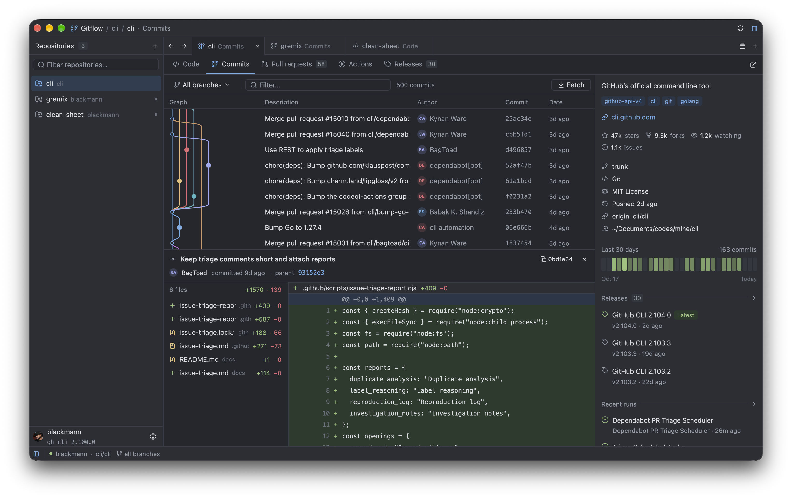

# Gitflow

Github web is just too slow and I don't like it. This project is almost totally vibecoded but with a lot of taste and thoughtfulness.

Requires Github CLI to be installed and logged in.

Designed mainly to cover most of my workflow. If you can't find what you want, please clone and vibecode the additional features.

Run `cargo run` for dev run. To install on your Mac, `./scripts/install-app.sh`

